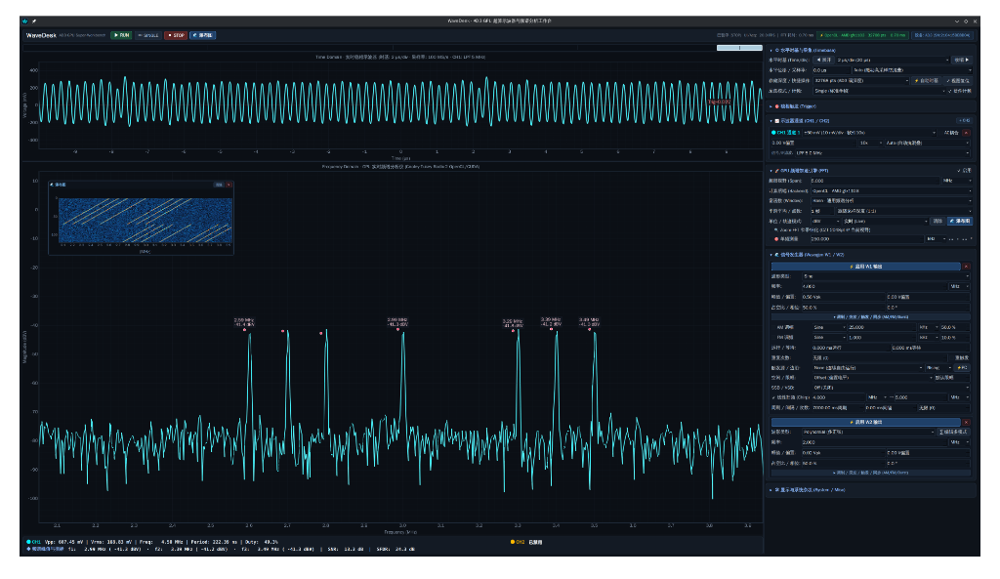

# WaveDesk

WaveDesk 是一个面向 Digilent Analog Discovery 3（AD3）的桌面工具，可以查看双通道波形、分析频谱，并控制双通道信号发生器。没有设备时，也可以用内置的模拟信号体验界面。



## 功能

- **示波器**：查看 CH1 和 CH2 波形，调整采样、通道和触发设置，并查看波形测量值。
- **频谱分析**：实时计算 FFT，显示峰值、幅度、THD、SNR 和 SFDR 等指标。支持 OpenCL GPU 加速，也可以使用 SciPy 在 CPU 上计算；安装 CuPy 后可尝试使用 CUDA 后端。
- **信号发生器**：控制 AD3 的 W1 和 W2 输出。
- **波形显示**：使用 OpenGL 绘制波形，支持余辉显示和峰值检测降采样；也可切换到软件渲染。

## 环境要求

- Python 3.12 或更高版本，以及 [uv](https://docs.astral.sh/uv/)。
- 使用真实设备时，需要连接 AD3 并安装 Digilent WaveForms Runtime，使系统能够加载 `libdwf.so`。
- 使用 OpenCL 加速需要可用的 OpenCL 驱动和 GPU；没有可用的 GPU 后端时可以使用 CPU。

## 运行

在项目目录下启动模拟模式：

```bash
./run.sh --demo
```

连接 AD3 后，不加 `--demo` 即可使用设备：

```bash
./run.sh
```

如果 OpenGL 渲染不可用，可以尝试软件渲染：

```bash
./run.sh --demo --renderer software
```

运行脚本通过 `uv run` 启动应用，会根据项目配置准备 Python 环境。也可以直接使用 `uv run wavedesk`，并传入相同的参数。

## 测试

```bash
uv run pytest
```
